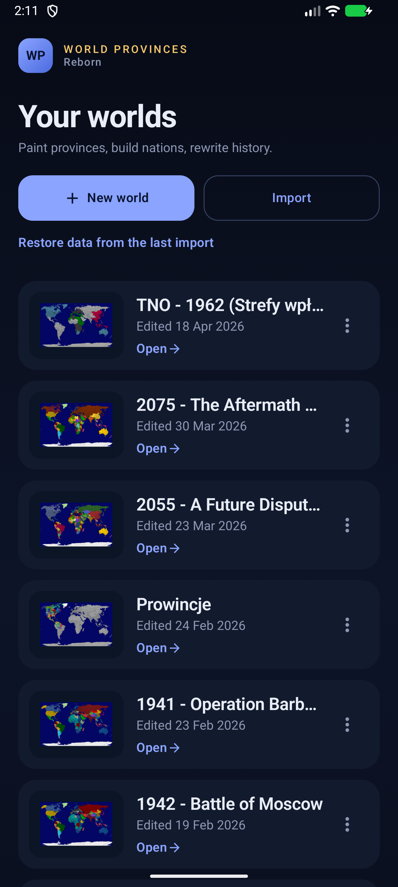
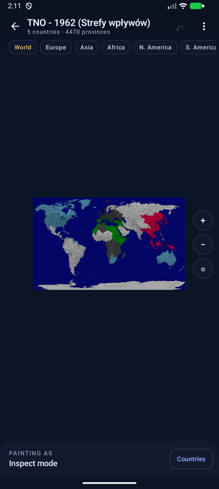
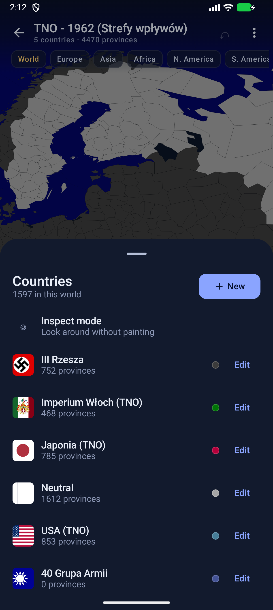

# World Provinces — Reborn

A modern, ad-free, offline rebuild of the map-painting game **World Provinces**
(`eu.uvdb.game.worldprovinces`, version 1.39.1). It reads the original app's
database without conversion, so an existing world can be continued exactly
where it was left off.

  

## What is this

The original is a sandbox map game: a world map split into 4,658 provinces,
217 built-in countries with flags and capitals, and a paint-style interaction
that lets you redraw borders and build your own civilisations.

This rebuild keeps the part that matters — the world and the saved game — and
replaces everything around it:

- **Material 3 interface** designed from scratch (dark, high-contrast, edge to edge).
- **No ads, no trackers, no network access at all.** The release manifest has no
  `INTERNET` permission.
- **Full database compatibility.** Worlds, countries, custom colours, custom
  flags, custom province names, borders, capitals and history rows all survive
  an import/export round trip.
- **Built for slow devices.** Geometry is parsed once and drawn from a cached
  bitmap; gestures never re-render the world.

## Features

| | |
|---|---|
| Map | Whole world, 4,658 provinces, 217 countries |
| Navigation | Pinch zoom, drag, double-tap, zoom buttons, continent jumps |
| Painting | Pick a country, tap provinces; every change is undoable |
| Countries | Create, rename, recolour, set a custom flag, delete |
| Provinces | Inspect, rename (custom names are stored in the original table) |
| Worlds | Unlimited maps, each with its own borders and countries |
| Backup | Import/export the original database, automatic backup before import |
| Offline | Everything works without a connection |

## Importing the original database

1. In the original app use **Input → Backup Database to File** and save the
   file (it is usually called `worldprovincesdb`).
2. Copy it to the phone's **Downloads** folder (or use any file provider).
3. In this app tap **Import database from the original app** and choose the file.
4. Confirm. The current data is backed up automatically and can be restored
   with **Restore data from the last import**.

The imported file is used as-is: this app reads and writes the same SQLite
schema (`co`, `pr`, `ma`, `mc`, `pc`, `hi`, `cf`, `re`), version 13. Exporting
produces a file the original app can read back.

Large exports are streamed straight into the app's database folder (never the
cache), with progress shown while copying, so a 500 MB original imports without
needing twice the free space. Only real saved worlds are listed: the original
app also stores internal `map_tech<timestamp>` scratch maps with `ma_status = 1`,
which are hidden exactly as the original hides them. Old copies are kept for
three imports, but automatic backups are skipped for databases over 256 MB.

## Building

Requirements: JDK 17, Android SDK with platform 35 and build-tools 35.0.0.

```bash
export JAVA_HOME=/usr/lib/jvm/java-17-openjdk-amd64
export ANDROID_HOME=/path/to/android-sdk
./gradlew :app:assembleRelease
```

The APK is written to `app/build/outputs/apk/release/app-release.apk` (~3.7 MB).

`versionCode` and `versionName` default to `1` / `2.0` for local builds and can be
overridden with `-PWP_VERSION_CODE=… -PWP_VERSION_NAME=…`.

The release build is signed with the key in `keystore/release.jks`
(alias/password: `wpreborn`). Keep that file if you want future builds to
install as updates over the current app.

### Continuous delivery

Every push to `main` runs [`.github/workflows/release.yml`](.github/workflows/release.yml),
which builds the signed APK on JDK 17 and publishes it as a GitHub release tagged
`v2.0.<run-number>`. The run number becomes the `versionCode`, so releases
always install over each other. Each run also uploads the APK as a workflow
artifact.

CI refuses to publish if the APK requests `INTERNET`, keeping the offline
guarantee enforceable.

Optional repository secrets (Settings → Secrets and variables → Actions):

| Secret | Purpose |
|---|---|
| `KEYSTORE_BASE64` | `base64 -w0 keystore/release.jks`; used in preference to the committed key |
| `KEYSTORE_PASSWORD` | keystore password (default `wpreborn`) |
| `KEY_ALIAS` | key alias (default `wpreborn`) |
| `KEY_PASSWORD` | key password (default `wpreborn`) |

Without them the committed key is used, and the resulting APK is signed with the
same identity as local builds.

Contributor notes live in [AGENTS.md](AGENTS.md).

### Regenerating the bundled data

The map data is extracted from the resource tables of the original APK:

```bash
python3 tools/extract_data.py /path/to/apktool/output
python3 tools/make_bootstrap.py
```

`extract_data.py` writes `app/src/main/assets/content/content.bin` and the flag
PNGs. `make_bootstrap.py` builds `bootstrap.db`, a ready-made first-run
database, so a fresh install opens instantly instead of inserting 10,000 rows.

## Performance notes

- Province polygons are parsed once into `android.graphics.Path` objects and
  kept in memory (~54,000 points).
- The visible world is rendered on a background thread into a reused bitmap.
  Panning and pinching only transform the last rendered bitmap, so no geometry
  is redrawn during a gesture.
- While a finger is down the viewport is still refreshed, at a relaxed rate and
  without borders or anti-aliasing, so newly revealed areas appear during the
  drag instead of only on release. A sharp frame always follows when the gesture
  ends.
- Country borders are drawn as one combined path instead of one stroke per
  province.
- Tap hit-testing uses bounding boxes first and polygon tests only for the few
  candidates under the finger.
- Home thumbnails render only for visible cards, and custom flag images are read
  from the database on demand; an imported world with 1,000+ custom flags never
  loads them all at once.
- Measured on the test emulator (software GPU): ~65 ms per full-world render,
  ~62 MB total PSS.

## Project layout

```
app/src/main/java/io/wpreborn/app/
  data/WorldContent.kt   content pack reader
  data/Geo.kt            paths, bounds, draw order, thumbnails
  data/WorldDb.kt        original-compatible SQLite schema
  data/WorldRepository.kt maps, painting, countries, import/export
  map/MapView.kt         renderer, gestures, hit testing
  ui/                    Compose screens and theme
tools/                   data extraction and bootstrap scripts
```

## Known limitations

- The original app's round-replay and statistics screens are not rebuilt; the
  `hi` history table is still written and preserved.
- Capital provinces are displayed and imported but not editable yet.
- Undo is available for the current session (300 steps per world).
- The UI is English only.

## Data and attribution

This is a personal, non-commercial project and is not affiliated with the
author of the original game. Map geometry, country metadata and flag images
were extracted from the copy of the original application provided by its owner.
National flags are public-domain symbols. If you intend to distribute the app
publicly, replace the extracted assets with your own or verify the licence
terms of the original content.
